# TeaLeaf Tracker – Ceylon Tea Estate Guide

**Course:** IT3133 – Individual Project  
**Author:** Chathuni Abeysinghe  

TeaLeaf Tracker is an offline React Native (Expo) mobile application developed to explore Sri Lanka's Ceylon tea heritage. The application allows users to discover regional tea varieties, understand elevation classifications, browse historical tea estates to visit, plan custom travel itineraries, and brew tea using an integrated step-by-step timer. Designed with an offline-first architecture, the application operates entirely without internet access or remote APIs.

---

## Features

- **Welcome and Onboarding:** First-launch splash view presenting app identity and Ceylon tea heritage, with onboarding completion persisted in device storage.
- **Offline Authentication & Local User Accounts:** Offline user registration and sign-in backed by SQLite with salted SHA-256 password hashing (via `expo-crypto`); persistent active session saved on the device (AsyncStorage `@tealeaf_session`); and secure log out with confirmation from the Settings screen.
- **Browse Teas:** Curated catalogue of 21 Ceylon tea varieties covering High-grown, Mid-grown, and Low-grown elevations, and Black, Green, White, and Silver Tips types.
- **Search and Filtering:** Real-time search by tea name, region, type, flavour notes, and elevation; dedicated filter screen with multi-select region, elevation, and tea type chips, supporting OR evaluation within a category and AND logic across categories, flexible sorting, active-filter badge, live result count, and one-tap clear all.
- **Sorting:** Database query sorting supporting alphabetical order (ascending and descending) and elevation hierarchy (High-grown to Low-grown).
- **Tea Details:** Detailed profiles including elevation classification, region, harvest season, flavour profile chips, descriptive background, and direct brewing guide integration.
- **Brewing Guide and Interactive Timer:** Steeping instructions covering ideal water temperature, steeping duration, leaf dosage, and tips for Black, Green, White, and Silver Tips teas. Features a countdown timer with start, pause, resume, reset, drift-free interval tracking, screen wake lock, haptic feedback, and local completion alerts.
- **Region Explorer:** Visual directory of Sri Lanka's six major tea-growing regions (Nuwara Eliya, Uva, Dimbula, Kandy, Ruhuna, and Sabaragamuwa) with elevation levels and direct navigation to filtered teas and estates.
- **Estates to Visit:** Directory of 10 visitable Ceylon tea estates with travel metrics (drive duration in minutes, distance in kilometres), factory tour availability, visiting seasons, and highlights.
- **Estate Details:** Comprehensive estate profile with factory tour status, road travel estimates, best seasons, tea types produced, and an itinerary toggle.
- **Favourites:** Save favourite teas with local persistence in SQLite, optimistic state updates, and quick removal.
- **My Trip (Itinerary Planner):** Custom travel itinerary saving selected estates with automatic real-time aggregation of total estimated drive time and cumulative travel distance.
- **Settings and Appearance:** Theme switcher supporting Light, Dark, and System preference modes; notification permission toggles; offline status confirmation; and informational links.
- **Static Information:** In-app reader for Privacy Policy, About TeaLeaf Tracker, and Contact details.
- **Responsive Layout:** Dynamic layout adapting to mobile, tablet, and desktop viewports (1, 2, or 3 columns) with clamped max-widths.
- **100% Offline Architecture:** Local JSON datasets seeded into an embedded SQLite database on first launch; all asset images bundled locally; zero network or API dependencies.

---

## Screens

| Screen Name | Route Name | File | Purpose |
| :--- | :--- | :--- | :--- |
| Welcome | `Welcome` | `src/screens/WelcomeScreen.tsx` | Introduces the app, records onboarding completion, and directs users to Login (or MainTabs if already logged in). |
| Login | `Login` | `src/screens/LoginScreen.tsx` | Local device sign-in view with email, secure password entry, inline validation, and link to sign up. |
| Sign Up | `SignUp` | `src/screens/SignUpScreen.tsx` | Account registration view with full name, email, salted password creation, and validation. |
| Home | `HomeTab` | `src/screens/HomeScreen.tsx` | Main dashboard with hero banner, quick navigation tiles, tea of the day, and featured teas. |
| All Teas | `Teas` / `AllTeas` | `src/screens/AllTeasScreen.tsx` | Searchable catalogue and grid of all Ceylon teas with region filtering and favourite toggles. |
| Filter Teas | `FilterTeas` | `src/screens/FilterScreen.tsx` | Filter selection view with multi-choice chips for region, elevation, and tea type. |
| Tea Details | `TeaDetails` | `src/screens/TeaDetailsScreen.tsx` | Detailed specifications, tasting notes, description, and brewing link for a selected tea. |
| Brewing Guide | `BrewingTab` | `src/screens/BrewingGuideScreen.tsx` | Segmented tea brewing parameters and interactive countdown timer. |
| Region Explorer | `RegionExplorer` | `src/screens/RegionExplorerScreen.tsx` | Visual guide to the six tea-growing regions with elevation data and links to related teas/estates. |
| Estates to Visit | `EstatesToVisit` | `src/screens/EstatesToVisitScreen.tsx` | Searchable directory of visitable tea estates with travel metrics and factory tour flags. |
| Estate Details | `EstateDetails` | `src/screens/EstateDetailsScreen.tsx` | Detailed estate profile with visiting details and an itinerary addition toggle. |
| Favourites | `FavouritesTab` | `src/screens/FavouritesScreen.tsx` | Displays user-favourited teas saved locally with removal options. |
| My Trip | `MyTrip` | `src/screens/MyTripScreen.tsx` | Itinerary planner displaying saved estates with aggregated drive duration and distance. |
| Settings | `Settings` | `src/screens/SettingsScreen.tsx` | Controls for theme mode (Light/Dark/System), notification preferences, and informational pages. |
| Information | `Info` | `src/screens/InfoScreen.tsx` | Static content viewer for Privacy Policy, About project details, and Contact information. |

---

## Tech Stack

| Technology | Version | Purpose |
| :--- | :--- | :--- |
| React Native | 0.88.1 | Cross-platform mobile application framework |
| Expo SDK | ~58.0.23 | Managed mobile application toolchain and runtime |
| TypeScript | ~6.0.3 | Strongly-typed application programming language |
| React | 19.3.0 | UI component library |
| React Navigation | ^7.5.1 | Routing and screen navigation architecture |
| `@react-navigation/native-stack` | ^7.21.0 | Native stack navigation for modal and drill-down views |
| `@react-navigation/bottom-tabs` | ^7.21.0 | Bottom tab navigation for primary app sections |
| `expo-sqlite` | ~58.0.15 | Embedded relational SQLite database for entities and user data |
| `expo-crypto` | ~58.0.8 | Cryptographic hashing (SHA-256) and random salt generation for local offline authentication |
| `@react-native-async-storage/async-storage` | 2.2.0 | Key-value storage for session tokens, theme, preferences, and onboarding flags |
| Context API | React Built-in | Global state management for authentication, theme, settings, favourites, filters, and trip planning |
| `expo-keep-awake` | ~58.0.3 | Screen awake lock while the brewing timer is counting down |
| `expo-haptics` | ~58.0.7 | Tactile feedback upon brewing timer completion |
| `expo-notifications` | ~58.1.8 | Local scheduled notifications when the brewing timer finishes |
| `@expo/vector-icons` (Ionicons) | ^15.0.2 | Consistent iconography across navigation and components |
| `react-native-safe-area-context` | ~5.11.1 | Safe area inset management across edge-to-edge device displays |
| `react-native-web` | ^0.21.4 | Web runtime support for browser-based demonstration |

---

## Data Architecture

The application is engineered as a 100% offline system with zero external API calls:

```
Bundled JSON Data (teas, estates, regions, brewing)
                      |
                      v
      initAndSeedDatabase() in App.tsx
                      |
                      v
   expo-sqlite Database ('ceylonteaguide.db')
   -------------------------------------------------
   - regions          : 6 Ceylon tea regions
   - teas             : 21 authentic tea varieties
   - estates          : 10 historical tea estates
   - brewing_guides   : 4 standard tea brewing profiles
   - favourites       : User-saved teas (Foreign Key -> teas)
   - trip_items       : User-saved estates (Foreign Key -> estates)
   - users            : Local user credentials (id, full_name, email, password_hash, salt, created_at)
   - app_metadata     : Version tracking ('data_version': '4')
```

1. **Local JSON Datasets:**
   - `src/data/teas.json`: 21 Ceylon tea entries with elevation, type, flavour notes, harvest seasons, and image keys.
   - `src/data/estates.json`: 10 historic estates with driving times, distances, tour status, highlights, and season recommendations.
   - `src/data/regions.json`: 6 Ceylon tea regions with elevation classes and geological descriptions.
   - `src/data/brewing.json`: 4 brewing specifications with temperature, steep minutes, leaf weights, and tips.
2. **Database Initialization and Seeding:**
   - On initial launch, `initAndSeedDatabase()` (`src/database/seed.ts`) executes table creation scripts (`src/database/schema.ts`).
   - Checks the `app_metadata` table for existing seeding status. If unseeded or versioned below current (`data_version: '4'`), it batch-inserts the local JSON records using parameterized SQL statements. Foreign key constraints are enforced (`PRAGMA foreign_keys = ON;`).
3. **User Persistence & Authentication:**
   - User credentials, salts, and hashed passwords are stored in SQLite (`users` table with columns: `id`, `full_name`, `email` [unique, lowercase], `password_hash`, `salt`, `created_at`). Plain-text passwords are never stored.
   - Active user session is saved securely on the device in `@react-native-async-storage/async-storage` under key `@tealeaf_session`.
   - Favourites and Trip Itineraries write directly to SQLite (`favourites` and `trip_items` tables) using cascade rules.
   - User preferences (Theme mode, Notification toggles, Tips toggle, Onboarding state) are stored via `@react-native-async-storage/async-storage`.

---

## Project Structure

```
TeaLeaf-Tracker/
├── assets/                          # Static application assets
│   ├── favicon.png                  # Web favicon
│   └── images/                      # Bundled local image assets
│       ├── adaptive-icon.png        # Android adaptive icon foreground
│       ├── app-icon.png             # General application icon
│       ├── brew_cup.jpg             # Brewing guide visual asset
│       ├── home_hero.jpg            # Home dashboard banner image
│       ├── logo.png                 # TeaLeaf Tracker application logo
│       ├── trip_leaf_decor.png      # Decorative UI graphic
│       ├── welcome_bg.jpg           # Welcome screen background image
│       ├── estates/                 # 10 estate photographic assets
│       ├── regions/                 # 6 tea region photographic assets
│       └── teas/                    # 8 categorized tea variety images
├── src/                             # Application source code
│   ├── components/                  # Reusable UI presentation components
│   │   ├── ScreenHeader.tsx         # Standardized screen header with back and action buttons
│   │   └── TeaImage.tsx             # Fallback-safe image wrapper for offline assets
│   ├── context/                     # Global state providers via React Context
│   │   ├── AuthContext.tsx          # Offline authentication state and session persistence
│   │   ├── FavouritesContext.tsx    # Bookmarked teas state and SQLite synchronisation
│   │   ├── FilterContext.tsx        # Multi-attribute tea filter and sort state management
│   │   ├── SettingsContext.tsx      # Notification and guidance settings persistence
│   │   ├── ThemeContext.tsx         # Light, Dark, and System theme management
│   │   └── TripContext.tsx          # Travel itinerary state and live metric calculations
│   ├── data/                        # Static JSON datasets and asset mappings
│   │   ├── brewing.json             # Brewing parameters by tea type
│   │   ├── estates.json             # Visitable Ceylon tea estates dataset
│   │   ├── images.ts                # Static require() registry for bundled offline images
│   │   ├── regions.json             # Ceylon tea regions dataset
│   │   └── teas.json                # Curated Ceylon tea catalogue
│   ├── database/                    # SQLite database implementation
│   │   ├── db.ts                    # SQLite database connection factory (expo-sqlite)
│   │   ├── queries.ts               # Parameterized SQL query and mutation functions
│   │   ├── schema.ts                # SQLite table definitions and DDL scripts
│   │   ├── seed.ts                  # Database seeding logic with version control
│   │   └── users.ts                 # Local user authentication, salted hashing, and queries
│   ├── hooks/                       # Custom React hooks
│   │   ├── useBrewTimer.ts          # Drift-free countdown timer with haptics and keep-awake
│   │   ├── useDebounce.ts           # Debounce utility for input handling
│   │   ├── useEstates.ts            # SQLite data fetching hook for estates
│   │   └── useTeas.ts               # SQLite data fetching hook for teas
│   ├── navigation/                  # Navigation configuration
│   │   ├── MainTabs.tsx             # Bottom tab bar navigator (Home, Teas, Brewing, Favourites)
│   │   ├── RootNavigator.tsx        # Root native stack navigator managing modals and screens
│   │   └── types.ts                 # TypeScript type definitions for navigation parameters
│   ├── screens/                     # Application screen components
│   │   ├── AllTeasScreen.tsx        # Tea catalogue screen with search and filtering
│   │   ├── BrewingGuideScreen.tsx   # Brewing guide and interactive timer screen
│   │   ├── EstateDetailsScreen.tsx  # Detailed estate view with itinerary action
│   │   ├── EstatesToVisitScreen.tsx # Estate directory screen with metrics
│   │   ├── FavouritesScreen.tsx     # Saved favourite teas list screen
│   │   ├── FilterScreen.tsx         # Multi-criteria filter selection screen
│   │   ├── HomeScreen.tsx           # Home dashboard screen
│   │   ├── InfoScreen.tsx           # Static informational viewer screen
│   │   ├── LoginScreen.tsx          # Local user sign-in screen with visibility toggle
│   │   ├── MyTripScreen.tsx         # Trip itinerary summary and list screen
│   │   ├── RegionExplorerScreen.tsx # Tea region directory screen
│   │   ├── SettingsScreen.tsx       # Application settings and theme screen
│   │   ├── SignUpScreen.tsx         # User registration screen with salted credential creation
│   │   ├── TeaDetailsScreen.tsx     # Tea profile and tasting notes screen
│   │   └── WelcomeScreen.tsx        # Welcome onboarding screen
│   ├── theme/                       # Global styling tokens
│   │   ├── colors.ts                # Light and dark colour palettes
│   │   ├── spacing.ts               # Spacing scales and border radii
│   │   └── typography.ts            # Font sizes, font weights, and line heights
│   ├── types/                       # Shared TypeScript domain interfaces
│   │   └── index.ts                 # Domain models (Tea, Region, Estate, BrewingGuide, etc.)
│   └── utils/                       # Utility helpers
│       ├── imageMap.ts              # Key-to-asset mapping and default fallback resolver
│       └── responsive.ts            # Viewport breakpoint and responsive layout hook
├── App.tsx                          # Root application bootstrap, DB setup, and provider hierarchy
├── app.json                         # Expo configuration manifest
├── index.ts                         # Entry point registering root component
├── metro.config.js                  # Metro bundler configuration with wasm extension support
├── package.json                     # Project dependencies and npm scripts
└── tsconfig.json                    # TypeScript compiler configuration
```

---

## How Navigation Works

Navigation is configured using React Navigation v7 with a two-tier structure: a Root Native Stack Navigator containing a Bottom Tab Navigator alongside secondary screens.

```
RootNavigator (Native Stack - initialRoute: Welcome)
├── Welcome (WelcomeScreen)
├── Login (LoginScreen)
├── SignUp (SignUpScreen)
├── MainTabs (BottomTabNavigator)
│   ├── HomeTab       -> HomeScreen
│   ├── Teas          -> AllTeasScreen
│   ├── BrewingTab    -> BrewingGuideScreen
│   └── FavouritesTab -> FavouritesScreen
├── AllTeas (AllTeasScreen)
├── FilterTeas (FilterScreen, modal slide-from-bottom presentation)
├── TeaDetails (TeaDetailsScreen, parameter: teaId)
├── RegionExplorer (RegionExplorerScreen)
├── EstatesToVisit (EstatesToVisitScreen, optional parameter: regionFilter)
├── EstateDetails (EstateDetailsScreen, parameter: estateId)
├── MyTrip (MyTripScreen)
├── Settings (SettingsScreen)
└── Info (InfoScreen, parameters: title, contentKey)
```

- **Authentication Flow:** Launching the app presents `WelcomeScreen`. Pressing **Get Started** inspects device authentication state: if an active session is detected in local storage, it transitions directly to `MainTabs`; otherwise, it directs to `LoginScreen`. Users can toggle freely between `LoginScreen` and `SignUpScreen`. Upon successful login or registration, the stack navigates forward via `navigation.replace('MainTabs')`. From the `SettingsScreen`, users can initiate **Log Out**, which issues a confirmation dialog, purges the local session from AsyncStorage, and resets the root stack back to `LoginScreen`.
- **Root Stack Navigator (`RootNavigator.tsx`):** Handles root-level transitions using native stack animations (`slide_from_right`). The filter view uses a card presentation with a `slide_from_bottom` animation.
- **Main Tabs (`MainTabs.tsx`):** Provides persistent bottom navigation across primary features. Tab height, label positioning, and maximum bar width adjust automatically based on responsive breakpoints.

---

## Responsive Design

The app implements dynamic layout adaptation through `useResponsive` (`src/utils/responsive.ts`), utilizing React Native's `useWindowDimensions` hook to re-render layouts on window resize or device rotation:

| Viewport Width | Breakpoint Category | Columns (`numColumns`) | Max Content Width | Form Max Width | UI Scale |
| :--- | :--- | :--- | :--- | :--- | :--- |
| `< 600px` | `phone` | 1 column | 600px | 600px | 1.00 |
| `600px - 900px` | `tablet` | 2 columns | 840px | 600px | 1.05 |
| `> 900px` | `desktop` | 3 columns | 1160px | 600px | 1.15 |

- **Column Grids:** FlatLists across `AllTeasScreen`, `RegionExplorerScreen`, `EstatesToVisitScreen`, `FavouritesScreen`, and `MyTripScreen` dynamically switch between 1, 2, or 3 columns based on `numColumns`.
- **Max Width Clamping:** Inner content containers apply `contentMaxWidth` or `formMaxWidth` aligned centrally (`alignSelf: 'center'`) to maintain clean readability and prevent visual stretching on widescreen tablets and desktop browsers.
- **Adaptive Tab Bar:** On tablet and desktop screens, the bottom tab bar is restricted to centered widths (700px on tablet, 860px on desktop) with elevated card styling.

---

## Getting Started

### Prerequisites

- Node.js (version 18.x or 20.x recommended)
- npm (bundled with Node.js)
- Expo Go application installed on an Android or iOS device (available via Google Play Store / Apple App Store), or an iOS Simulator / Android Emulator.

### Installation

1. Clone or extract the project repository to your local machine:
   ```bash
   cd TeaLeaf-Tracker
   ```
2. Install project dependencies:
   ```bash
   npm install
   ```

### Running the Application

1. **Start the Expo Development Server:**
   ```bash
   npx expo start
   ```
2. **Open on Physical Mobile Device:**
   - **Android:** Open the Expo Go app and scan the terminal QR code.
   - **iOS:** Open the native Camera app, scan the terminal QR code, and open the prompt in Expo Go.
   *(Note: Ensure your mobile device and computer are connected to the same Wi-Fi network).*
3. **Open in Web Browser:**
   ```bash
   npx expo start --web
   ```
   Or press `w` in the active terminal running `npx expo start`.

---

## Screenshots

Main screens of the application:

| Welcome Screen | Home Dashboard | All Teas Screen |
| :---: | :---: | :---: |
| 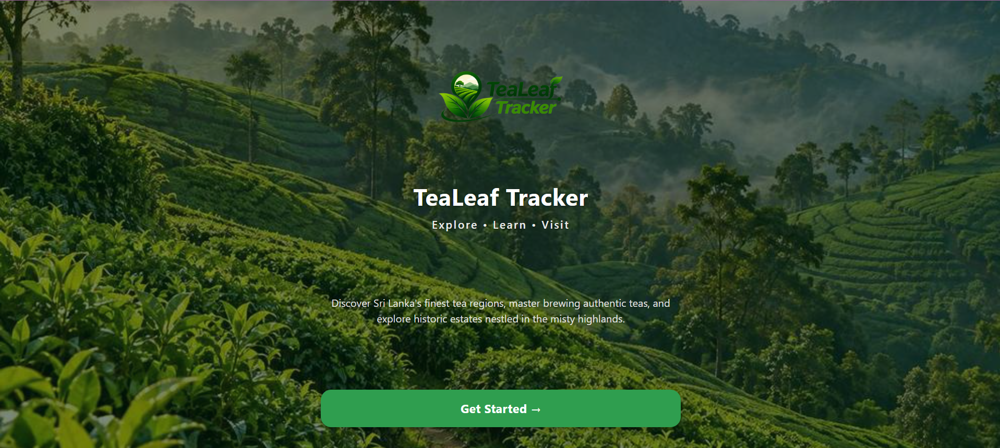 | 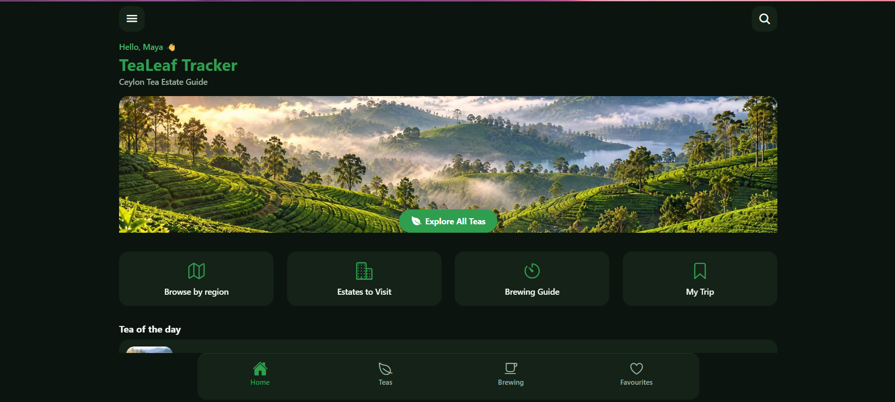 | 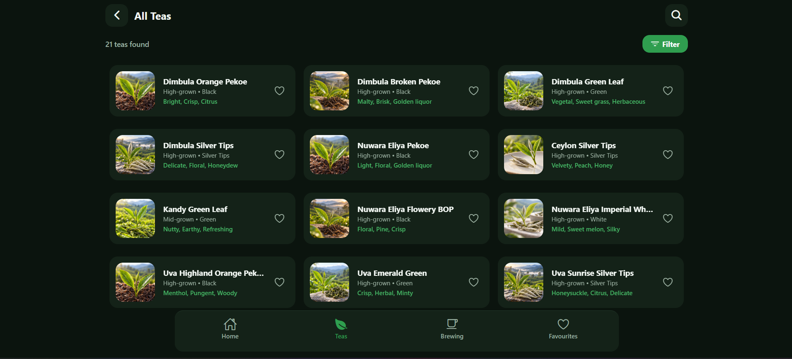 |

| Tea Details | Brewing Guide & Timer | Region Explorer |
| :---: | :---: | :---: |
| 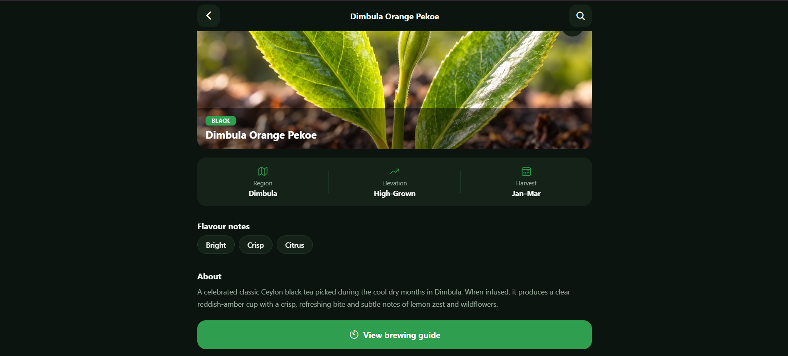 | 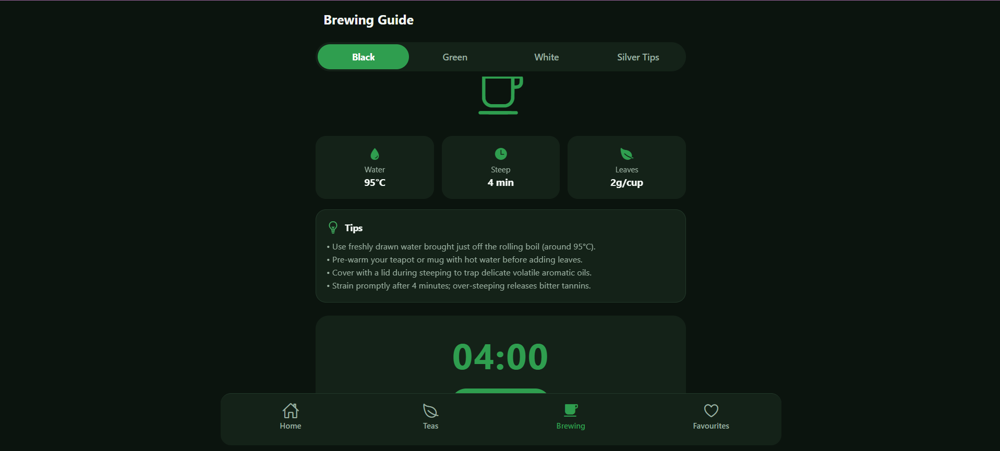 | 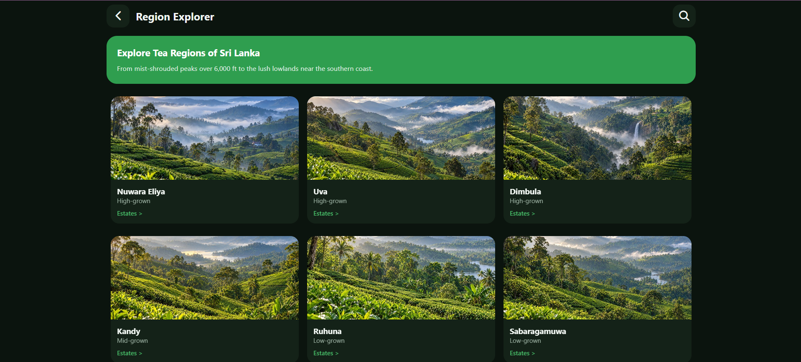 |

| Estates to Visit | Estate Details | My Trip Itinerary |
| :---: | :---: | :---: |
| 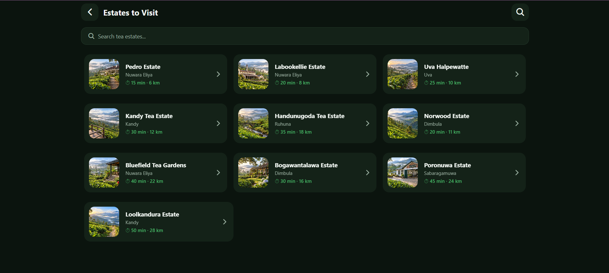 | 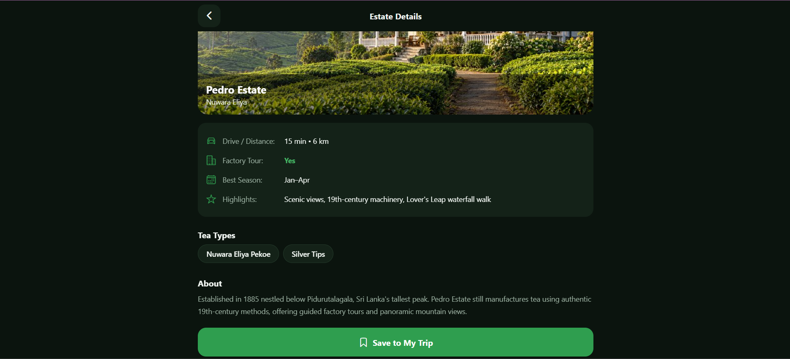 | 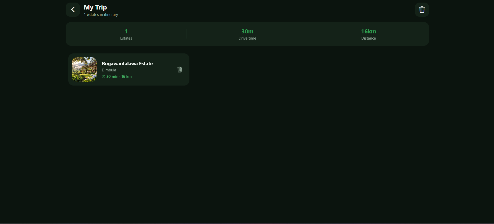 |

| Favourites | Filter Screen | Settings |
| :---: | :---: | :---: |
| 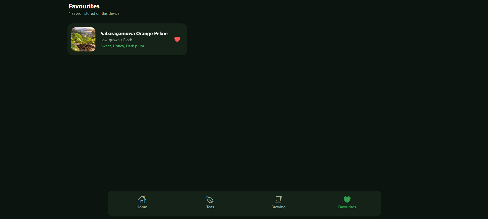 | 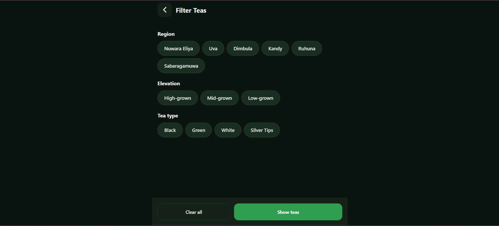 | 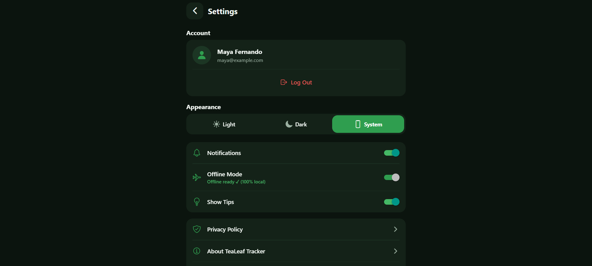 |

| Login Screen | Sign Up Screen |
| :---: | :---: |
| 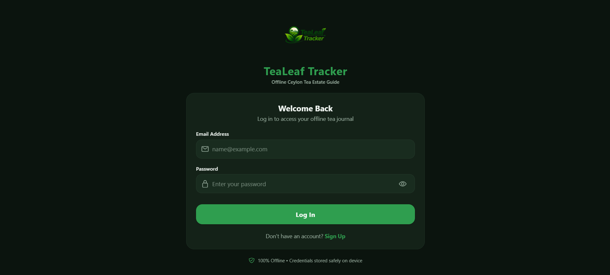 | 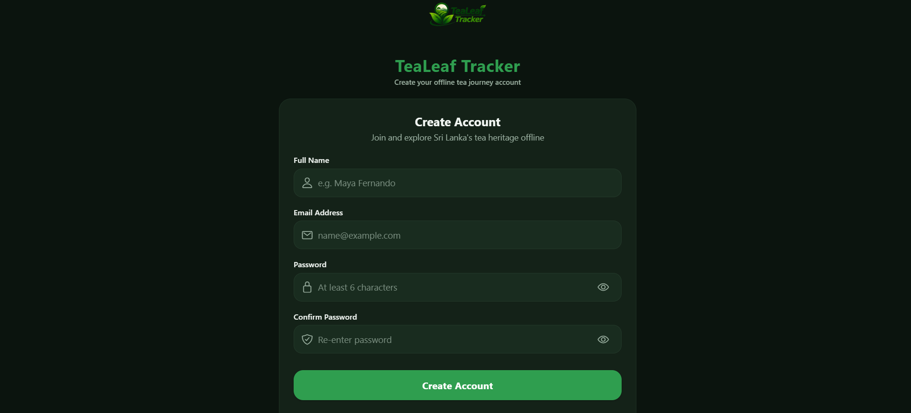 |


---

## Git Workflow

The project follows a standard structured Git branching and review model:

- **Branching Strategy:**
  - `main`: Production-stable branch representing release-ready code evaluated for project milestones.
  - `feature/<feature-name>`: Dedicated feature development branches (e.g., `feature/data-and-database`).
  - `fix/<fix-name>`: Bug correction and hotfix branches (e.g., `fix/image-mapping`).
  - `docs/<doc-name>`: Documentation and project specification updates.
- **Pull Requests:**
  - Feature branches are pushed to GitHub and integrated into `main` strictly through Pull Requests (PRs).
  - Changes are developed on separate branches and merged into `main` through pull requests.
- **Commit Message Conventions:**
  - Commit messages use the imperative present tense with an initial capital letter describing the exact change (e.g., `Add local datasets and SQLite database seeding`, `Configure app name, root providers and Metro`, `Set up Expo project, theme and responsive utilities`).

---

## Known Limitations and Future Improvements

### Known Limitations

1. **Dual Data Sourcing in Views:** While SQLite is initialized and seeded on app startup, several listing views (`HomeScreen`, `AllTeasScreen`, `EstatesToVisitScreen`) query bundled JSON datasets in memory for synchronous filtering and instant responsiveness, while SQLite query hooks (`useTeas`, `useEstates`) and database tables handle database queries, Favourites, and Trip persistence.
2. **Static Distance and Travel Estimates:** Drive times and kilometre distances for tea estates are fixed reference values rather than live GPS estimations based on current device location.
3. **Native Device Features on Web:** Features relying on device hardware (`expo-haptics`, `expo-keep-awake`, and local push notifications) gracefully degrade when running in a web browser.
4. **Local-Only Device Authentication:** User authentication is entirely local to the device using SQLite and AsyncStorage. There is no remote online backend, cloud synchronisation across devices, or remote password recovery mechanism if credentials are lost.

### Future Improvements

1. **Unified SQLite DAO Layer:** Fully integrate all catalog queries through asynchronous SQLite query hooks (`useTeas`, `useEstates`) with SQLite Full-Text Search (FTS5) for rapid multi-token search.
2. **Interactive Offline Mapping:** Incorporate offline vector mapping (`react-native-maps`) to visually display estate pins and calculated driving routes across Sri Lanka's tea regions.
3. **Itinerary Export:** Add functionality to export or share the My Trip itinerary as a downloadable text or PDF summary.

---

## Author

- **Name:** Chathuni Abeysinghe
- **Degree:** BSc (Hons) Information Systems
- **Institution:** University of Moratuwa
- **Course:** IT3133 – Individual Project
